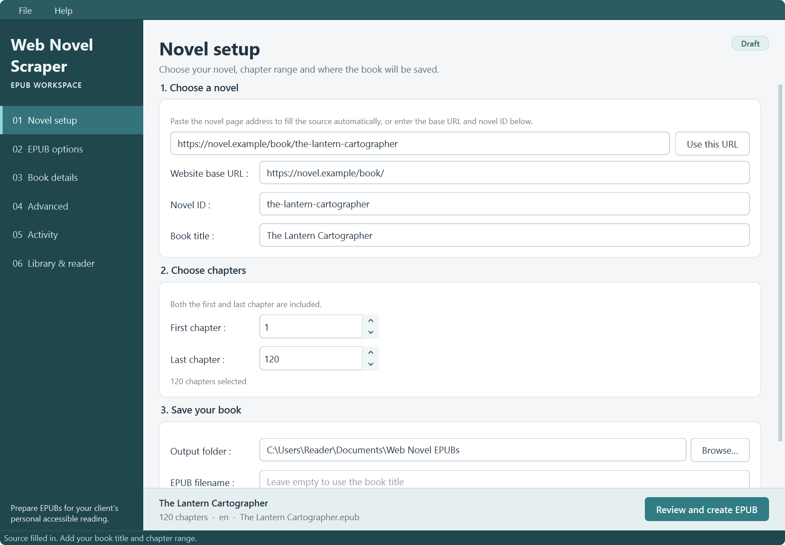
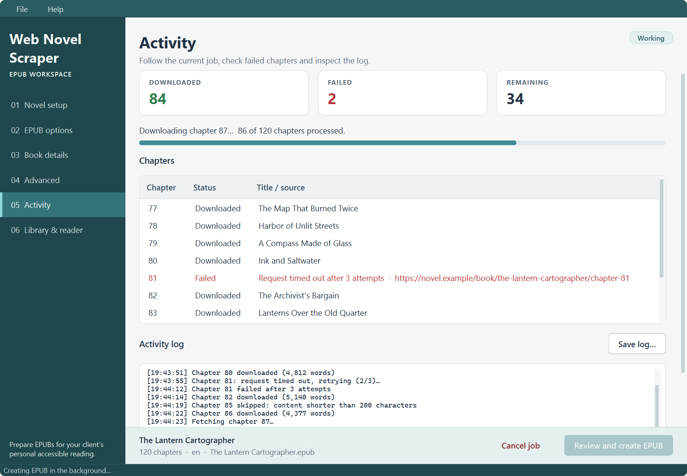

# Web Novel Scraper

An accessibility tool to help an individual blind person convert web novels into EPUB files for reading with text-to-speech (TTS) software, with support for footnotes, chapter notes, cover images, and more.

<p align="center">
  
  
</p>

## Important Note

**Current Compatibility**: This tool has been specifically developed and tested for one certain website where "lite" reading material exists in this "novel world" of ours 😉. While it works flawlessly there, using it elsewhere will in most cases require modifications to the content selection logic.

**Need help?** You have options:

1. Modify the content selectors yourself using the code comments below
2. Open an issue on GitHub - if I have time between reading chapters 📚, I might help adapt it

## For Developers

If you want to adapt the scraper for a different website, the site defaults and content cleaning live in two focused modules:

- **Site selectors & ad rules** — [webnovel/settings.py](webnovel/settings.py) (`SITE_PROFILES` and `DEFAULT_SITE_PROFILE`): add a `SiteProfile` entry with the site's domain, title selector, content selector, and optional strip selectors. Both the desktop app and CLI pick it up automatically.
- **TTS cleaning & note filtering** — [webnovel/cleaning.py](webnovel/cleaning.py): pure HTML/text functions (`clean_html_content`, `repair_split_words`, `tidy_for_speech`, `extract_chapter_parts`, `parse_chapter_elements`) with no network or Qt dependencies.

**Debug/Modify:**

```bash
python WebNovelScraper.py --debug  # Writes full raw HTML & cleaning decisions to scraper_detailed.log
```

## Intended Purpose

The sole purpose of this app is to help an individual blind person create EPUB files and read them using text-to-speech (TTS) software. It is intended exclusively for this personal accessibility purpose and is not meant to be used for any other purpose.

Commercial use and content redistribution are outside this intended purpose. **Support the original content creators** by visiting their sites and, if possible, purchasing official releases.

## Features

- Downloads and converts web novels to EPUB format
- Customizable metadata (author, translator, creator)
- Cover image support with automatic resizing and optimization
- Footnotes support with proper linking
- Chapter notes support
- Simple chapter naming option
- Clean content filtering
- Text-to-speech friendly text: words split with dots (`s.h.i.+eld`) are rejoined, missing spaces between sentences are added, and site watermarks, links, `[email protected]` placeholders, `(TL: ...)` notes, footnote marks, separator lines and decorative symbols are removed
- Progress tracking with real-time status
- Error handling and retry mechanism
- Rate limiting to prevent server overload
- Debug logging
- Cross-platform support (Windows, Linux, Mac)
- Native desktop interface with six organized sections
- Background EPUB creation, chapter results, cancellation and downloadable logs
- Saved project settings and automatic draft restoration
- Recent EPUB library, chapter text preview and reading with installed TTS voices
- Command-line interface with both interactive and argument modes

## Requirements

- Python 3.10 or higher
- pip (Python package installer)
- For built-in read-aloud: a system TTS engine and installed voices

## Installation

1. Clone or download this repository
2. Navigate to the project directory
3. Run the installation script:

For Windows users:

```bash
run.bat
```

For Linux/Mac users:

```bash
chmod +x run.sh
./run.sh
```

The launch scripts create a local `webnovel_env` environment, install the dependencies on first run (or whenever `requirements.txt` changes), and open the desktop app. Subsequent launches skip `pip` so the app starts quickly and works offline. Pass `--update` first (`run.bat --update`, `run.bat --update --cli`, or `./run.sh --update`) to upgrade dependencies manually.

## Usage

### Desktop workspace

Run `run.bat` on Windows or `./run.sh` on Linux/Mac. After building the standalone executable, you can also open `dist/WebNovelScraper.exe` on Windows without installing Python.

The sidebar separates the workflow into six sections:

| Section | What you can do |
| --- | --- |
| **Novel setup** | Paste a full novel or chapter URL to fill the source, enter a title, choose the chapter range, and select the output folder and filename. |
| **EPUB options** | Include or exclude footnotes and translator/chapter notes, and choose original or simple chapter headings, or leave headings out of the text so text-to-speech does not read them. |
| **Book details** | Set author, translator, creator/publisher, EPUB language, and an optional cover image URL. |
| **Advanced** | Set request rate, timeout, retry attempts, user agent, title/content CSS selectors, minimum chapter length, cover size/ratio, and detailed debug logging. |
| **Activity** | Track chapter progress, inspect downloaded and failed chapters, save the activity log, and open or preview the finished EPUB. |
| **Library & reader** | Open existing EPUBs, revisit recent books, preview chapter text, change text size, and read aloud using installed system voices. |

Click **Review and create EPUB** to check the settings before starting. EPUB creation runs in the background, so the window stays responsive. Existing EPUBs require confirmation before replacement; they are replaced only after the new book is complete. If some chapters fail, the EPUB contains the successful chapters and Activity lists the missing chapter numbers. If every chapter fails, no EPUB is created.

**Cancel job** stops between requests and interrupts retry waits. An active network request must finish or time out before cancellation completes. Cancelling leaves existing EPUBs unchanged and does not save a partial book.

Use **File → Save settings** and **File → Load settings** to reuse a project. The app also remembers the current draft, window size, reader text size, and recent books on exit. Diagnostic logs are stored under the app's local data folder; each job shows its full log path in Activity. Detailed debug logs can contain chapter text and source URLs.

The reader shows plain chapter text in EPUB reading order. **Read aloud** uses installed system voices; it reads the selected chapter. **Pause/Resume** is available when the selected TTS engine supports it. You can also open the EPUB in your preferred reading app. TTS availability depends on your operating system and installed speech engines/voices; on Linux this may require installing a supported speech engine separately.

Changing CSS selectors can adapt basic content targeting to another website, but site-specific cleaning rules may still require code changes.

### Command-line interface

The original command-line interface remains available using the local environment:

```powershell
.\webnovel_env\Scripts\python.exe WebNovelScraper.py
# Or use the launcher:
.\run.bat --cli
```

On Linux/Mac, use `webnovel_env/bin/python WebNovelScraper.py` or `./run.sh --cli`. The examples below assume you have activated this environment.

Interactive Mode:

```bash
python WebNovelScraper.py
```

Command-line Mode:

```bash
python WebNovelScraper.py [options]
```

Command-line Options:

- `--url`: Base URL for the web novel website
- `--novel-id`: Novel ID from the URL
- `--start`: First chapter number to download
- `--end`: Last chapter number to download
- `--title`: Novel title for the EPUB file
- `--output-dir`: Directory where the EPUB will be written (default: current directory)
- `--output`: Output EPUB filename or path (relative paths resolve under `--output-dir`)
- `--overwrite`: Replace an existing EPUB file if present
- `-y`, `--yes`: Skip interactive prompts and confirmation (for scripted runs)
- `--language`: EPUB language code (default `en`)
- `--debug`: Enable debug mode (writes `scraper_detailed.log` into the output directory)
- `--cover-url`: Direct URL to cover image
- `--author`: Author name
- `--translator`: Translator name
- `--creator`: Creator name
- `--title-selector`: Custom CSS selector for the chapter title (overrides site defaults)
- `--content-selector`: Custom CSS selector for the chapter content container (overrides site defaults)
- `--requests-per-second`: Maximum requests per second (default `2.0`)
- `--timeout`: Request timeout in seconds (default `30`)
- `--retries`: Retry attempts per chapter for transient errors (default `3`)
- `--simple-chapters`: Use simple chapter numbering
- `--no-headings`: Leave chapter headings out of the text so text-to-speech goes straight into the story (chapter names stay in the table of contents)
- `--include-footnotes`: Include footnotes in output
- `--include-notes`: Include chapter notes in output
- `--chapter-prefix`: Text before the chapter number in chapter URLs (default `chapter-`)
- `--from-folder`: Build from a chapter file, or a folder of them, saved in the browser instead of downloading

Example:

```bash
python WebNovelScraper.py --url "https://example.com/novel/" --novel-id "novel-name-123" --start 1 --end 10 --title "My Novel" --cover-url "https://example.com/cover.jpg" --author "Author Name" --simple-chapters
```

### Chapters saved from the browser

Some websites block the app with a browser check and only show chapters in a real browser. For those, `browser/collect-chapters.js` collects the chapters your browser shows.

In the desktop app, the browser check is detected when you click **Use this URL** or start a job, and **Get chapters from your browser** opens on Novel setup:

1. Fill in the source and chapter range, then click **Copy script**. The script is made for that book and range.
2. Open a chapter page of the book in your browser, press `F12`, open **Console**, paste the script and press Enter.
3. Confirm the first and last chapter in the popups. All chapters are saved to one file in Downloads.
4. Click **Browse…** to choose a saved `.html` file—or **Folder…** to import a folder of saved chapter batches—and the chapter range fills in automatically. Then click **Review and create EPUB**.

From the command line, paste `browser/collect-chapters.js` as it is on a chapter page whose address ends in the chapter number, move the saved files into `imports/` and build the EPUB:

```bash
python WebNovelScraper.py --from-folder imports --title "My Novel" --simple-chapters
```

`--from-folder` takes one saved file or a folder of them. Use `--start` and `--end` to build only part of the saved chapters. Saved chapters get the same text-to-speech cleanup as downloaded ones.

## Building Executable

To create a standalone executable:

For Windows:

```bash
build_exe.bat
```

For Linux/Mac:

```bash
chmod +x build_exe.sh
./build_exe.sh
```

## File Structure

```
project/
  ├── WebNovelDesktop.py            # Desktop interface
  ├── WebNovelScraper.py            # Command-line interface
  ├── webnovel/                     # Shared scraping, cleaning, EPUB, and job modules
  ├── webnovel_assets/              # UI SVG icons and application icon (icon.ico)
  ├── browser/collect-chapters.js   # Browser DevTools collector for blocked sites
  ├── pyproject.toml                # Package metadata, optional extras, and Ruff config
  ├── requirements.txt              # Runtime Python dependencies
  ├── build_exe.bat                 # Windows executable build script
  ├── build_exe.sh                  # Linux/Mac executable build script
  ├── build.bat                     # Windows build wrapper
  ├── build.sh                      # Linux/Mac build wrapper
  ├── run.bat                       # Windows run script (offline-friendly after first run)
  ├── run.sh                        # Linux/Mac run script (offline-friendly after first run)
  ├── WebNovelScraper.spec          # Desktop executable build configuration
  ├── tests/                        # Non-Qt service/cleaning tests and PySide6 GUI tests
  ├── .github/workflows/ci.yml      # Ruff lint, unit/GUI tests, and wheel packaging CI
  ├── docs/screenshots/             # README screenshots
  ├── README.md                     # Documentation
  ├── .gitignore                    # Git ignore file
  ├── build/                        # Build output directory
  └── dist/                         # Distribution output directory
```

## Advanced Features

- **Automatic Cover Processing**: Resizes and optimizes cover images to proper aspect ratio
- **Smart Content Filtering**: Removes ads and unwanted elements
- **Configurable Rate Limiting**: Prevents server overload
- **Progress Tracking**: Real-time progress display with success/failure counts
- **Error Recovery**: Automatic retry mechanism for failed downloads
- **Debug Logging**: Detailed logging for troubleshooting

## Development checks

Install the dev dependencies (`ruff`), then run the linter and full test suite (Windows):

```powershell
.\webnovel_env\Scripts\python.exe -m pip install -e ".[dev]"
.\webnovel_env\Scripts\python.exe -m ruff check .
.\webnovel_env\Scripts\python.exe -W default -W error::ResourceWarning -m unittest discover -s tests -v
```

On Linux/Mac, install with `webnovel_env/bin/python -m pip install -e '.[dev]'`, then run `webnovel_env/bin/python -m ruff check .` and `webnovel_env/bin/python -W default -W error::ResourceWarning -m unittest discover -s tests -v` (set `QT_QPA_PLATFORM=offscreen` on headless machines). To run only the non-Qt tests:

```powershell
.\webnovel_env\Scripts\python.exe -m unittest tests/test_jobs.py tests/test_saved_chapters.py tests/test_reliability.py tests/test_phase2_cli_and_modules.py -v
```

The tests use a local fixture website to verify the complete desktop job through chapter fetching, content options, cover processing, EPUB writing, preview, progress, saved settings, cancellation and failure handling. They do not download novels from external websites.

## Troubleshooting

If you encounter issues:

1. Check your internet connection
2. Verify the Novel ID and URL are correct
3. Run with --debug flag for detailed logging
4. Check scraper_detailed.log for error messages
5. Ensure all dependencies are installed correctly
6. Try running with different rate limiting settings if experiencing timeouts

## Future Development Roadmap

### Maybe Implement in Future

- **Architecture**
  - Project code modularization

- **Content Processing**
  - Better content cleaning

### Will See

- **Content Targeting**
  - Content boundary detection

- **Content Processing**
  - Better formatting preservation
  - Better metadata handling

### I Don't Think So

- **Architecture**
  - Plugin system for different sites
  - Transformation pipeline
  - Docker container
  - Machine learning features

Note: This roadmap reflects an honest assessment of future development possibilities. The "Maybe Implement in Future" features are those that could realistically be added if they prove necessary. "Will See" features depend on user feedback and project evolution. "I Don't Think So" acknowledges features that, while interesting, are likely beyond the scope of a single-developer hobby project.

## License

This project is intended solely for the personal accessibility purpose described above. Use responsibly and in accordance with the terms of service of the target websites.
